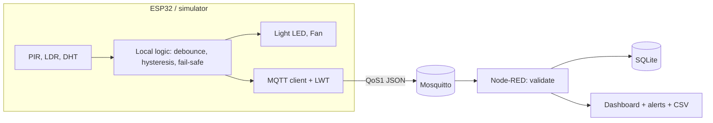

# Phase 1 - Design: Classroom Module (simulated)

Device: `CLASS-A-ESP32-01` | Building `BLOCK-A` | Zone `ROOM-204` | Campus `CHRIST-DEMO`
Status: **simulated** (no hardware). Every simulated message carries `"source":"simulated"` (extra field; the contract allows additions, required fields are unchanged).

## 1. Use case
A classroom saves energy and stays comfortable automatically:
- Occupied + dark -> light ON. Unoccupied 30 s continuously -> light OFF.
- Occupied + temp > 30 C -> fan ON. Temp < 27 C -> fan OFF (hysteresis, stops chattering).
- Dashboard shows occupancy, temperature, light level, light/fan state, device health, alerts.

## 2. Components (target real build; simulated tonight)
| Part | Role | Note |
|---|---|---|
| ESP32 DevKit (30/38-pin) | MCU + Wi-Fi | 3.3 V logic |
| PIR (HC-SR501) | occupancy | 5 V supply, 3.3 V-compatible output (VERIFY on your board) |
| LDR + 10 kOhm | light level | voltage divider -> ADC |
| DHT22 (or DHT11) | temperature | DHT11 is +/-2 C, coarse |
| LED + 220 Ohm | "classroom light" | |
| Low-voltage DC fan + NPN/MOSFET + flyback diode | cooling | never drive fan directly from a GPIO |

## 3. Block diagram


## 4. Pin map (ASSUMPTION - verify against your board's pinout)
| Signal | GPIO | Why |
|---|---|---|
| PIR out | 27 | plain digital input |
| LDR divider | 34 | ADC1 (ADC2 is unusable while Wi-Fi is on), input-only |
| DHT22 data | 15 | + 10k pull-up if bare sensor |
| Light LED | 26 | via 220 Ohm |
| Fan driver | 25 | to transistor base via 1k |
| Status LED | 2 | on-board LED = Wi-Fi/MQTT state |

## 5. Thresholds (all configurable constants)
| Name | Value |
|---|---|
| Dark if LDR % < | 30 (calibrate in Phase 3) |
| Vacancy timeout | 30 s |
| Fan ON / OFF | > 30 C / < 27 C |
| Telemetry period | 10 s |
| Heartbeat | 45 s |
| Offline after | 120 s |
| Valid ranges | temp -10..60 C, light 0..100 %, occupancy_detected bool |
| Sensor-failure rule | DHT read NaN 3x in a row -> fan OFF, alert `sensor_failure` |

## 6. Fixed contract (this module)
Topics: `christ-smart-campus/v1/classroom/BLOCK-A/CLASS-A-ESP32-01/{telemetry|status|alerts}`
Metrics published: `occupancy_detected`, `temperature`, `light_level`, `device_online` (one message per metric, as the contract has single metric/value).

```json
{"schema_version":"1.0","campus_id":"CHRIST-DEMO","module":"classroom","building_id":"BLOCK-A","zone_id":"ROOM-204","device_id":"CLASS-A-ESP32-01","timestamp":"2026-11-15T20:00:00Z","metric":"temperature","value":29.2,"unit":"C","status":"normal","source":"simulated"}
```
Units: temperature `C`, light_level `pct`, occupancy_detected `bool`, device_online `bool`.
Topic ambiguity: the spec says `{building_or_zone}`; I use building (`BLOCK-A`). VERIFY against the PDF wording.

## 7. Draft test plan
| ID | Test | Expected |
|---|---|---|
| M1 | Normal: occupied, dark, 25 C | light ON, fan OFF, status normal |
| M2 | Threshold: 31 C occupied | fan ON, alert raised |
| M3 | Boundary: 29, 30, 30.1, 27, 26.9 C | fan flips only at >30 and <27 |
| M4 | Sensor disconnect: DHT NaN x3 | fan OFF, `sensor_failure` alert |
| M5 | Recovery: sensor returns / stationary occupant | alert clears, logic resumes |
| M6 | Vacancy: no motion 30 s | light OFF only after 30 s |
| T1-T7 | Common (valid feed, missing field rejected, unknown device flagged, offline timeout, reconnect, alert correct, units + last update) | per spec |

Stationary occupant: PIR stops firing for a still person; a 30 s timeout is short for that case, so document it as a known limitation.

## 8. Plan: TONIGHT (~6-8 h, compressed)
| Block | Time | Output |
|---|---|---|
| Phase 1 design (this file) | 0:30 | design + test plan |
| Phase 2 skeleton: Mosquitto + Node-RED + SQLite + one simulated message | 1:30 | pipeline proven |
| Phases 3-5 merged: Python simulator with the exact logic (state machine, hysteresis, LWT, heartbeat) + Arduino sketch written but flagged UNTESTED | 1:30 | simulated device |
| Phase 6 minimal: validation, stale/offline, alerts+ack, filters, CSV, roles | 2:00 | dashboard |
| Phase 8: run tests, screenshots, demo script | 1:00 | evidence |
| Report + viva | after tonight | |

Skipped tonight: optional 5-module simulator (Phase 7), real-hardware calibration. State this honestly in the report: sensor accuracy and PIR behaviour are NOT validated.

## 9. Simulation approach
Wokwi cannot reach a local Mosquitto without its paid private gateway, so tonight's "ESP32" is a Python script running the same state machine as the firmware. The Arduino sketch is delivered as future work, labelled untested.

## 10. Chosen stack (defaults)
Mosquitto (Windows service) + Node-RED (with node-red-dashboard + node-red-node-sqlite) + SQLite. Windows 11, localhost only, anonymous disabled with a password file.
